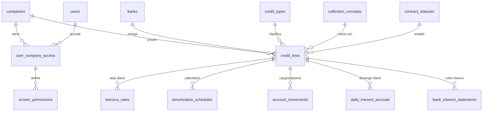
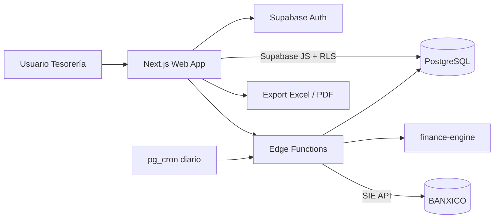

# OMEX Treasury — Sistema de Control y Tesorería de Financiamientos

> Documento de arquitectura y especificación técnica · v1.0
> Origen: especificación funcional de 15 mockups ("Pantallas del proyecto OMEX").

---

## Tabla de contenidos

1. [Visión general y alcance](#1-visión-general-y-alcance)
2. [Modelo de datos (ERD lógico)](#2-modelo-de-datos-erd-lógico)
3. [Reglas de negocio y lógica financiera](#3-reglas-de-negocio-y-lógica-financiera)
4. [Arquitectura y stack tecnológico](#4-arquitectura-y-stack-tecnológico)
5. [Estructura del repositorio](#5-estructura-del-repositorio)
6. [Plan de implementación por sprints](#6-plan-de-implementación-por-sprints)
7. [Hallazgos y puntos abiertos de la especificación](#7-hallazgos-y-puntos-abiertos-de-la-especificación)
8. [Apéndice: mapa mockup → módulo](#8-apéndice-mapa-mockup--módulo)

---

## 1. Visión general y alcance

### 1.1 Problema

La tesorería de OMEX ACEROS administra múltiples líneas de financiamiento con distintos bancos e instituciones (Banorte, BanCoppel, SOFOM, almacenadora, etc.). Hoy el control de vencimientos, amortizaciones e intereses depende de hojas de cálculo: el cálculo de intereses contra la TIIE diaria es manual y la conciliación contra el cobro real del banco es laboriosa.

### 1.2 Solución

Aplicación web multiempresa que centraliza:

- **Catálogos** (tipos de crédito, conceptos de cobro, bancos, estatus de contrato).
- **Ficha técnica de cada línea de crédito** (contrato, cuenta de cargo, importe, fechas, tasa/sobretasa, estatus).
- **Motor de cálculo financiero**: tablas de amortización con pago *bullet*, intereses diarios de cuenta corriente (TIIE + sobretasa) y conciliación *Ints. Omex* vs. *Según Banco*.
- **Histórico de TIIE** (BANXICO) asociado a cada línea.
- **Reportes consolidados** por tipo de línea y reporte macro de todas las líneas.
- **Control de acceso**: un usuario puede operar sobre varias empresas y ver únicamente las pantallas autorizadas.

### 1.3 Alcance

| Dentro de alcance (v1) | Fuera de alcance (v1) |
|---|---|
| CRUD de catálogos y líneas de crédito | Contabilización automática (pólizas ERP) |
| Motor de amortización y de intereses | Ejecución de pagos / integración bancaria (SPEI) |
| Carga manual y automática de TIIE | Autorización multinivel de movimientos |
| Conciliación manual contra estado de cuenta | Lectura automática de estados de cuenta (OCR/CFDI) |
| Reportes por tipo de línea y macro; exportación Excel/PDF | Pronósticos y escenarios de tasa |
| Multiempresa + RBAC por pantalla | Aplicación móvil nativa |

### 1.4 Usuarios y roles

| Rol | Descripción |
|---|---|
| `admin` | Administra catálogos, usuarios, empresas y todas las líneas. Define campos de "línea de captura". |
| `treasury` | Opera líneas, captura movimientos y tasas, concilia. |
| `viewer` | Solo consulta pantallas autorizadas y reportes. |

---

## 2. Modelo de datos (ERD lógico)

Motor: **PostgreSQL 15+ (Supabase)**. Convenciones: `snake_case`, PK `uuid` (`gen_random_uuid()`), montos `numeric(18,2)`, tasas `numeric(9,6)` (en porcentaje, p. ej. `10.782700`), fechas `date`, auditoría con `created_at`, `updated_at`, `created_by`.

### 2.1 Diagrama



### 2.2 Catálogos

**`credit_types`**

| Columna | Tipo | Constraints | Notas |
|---|---|---|---|
| id | uuid | PK | |
| code | text | NOT NULL, UNIQUE | `SIMPLE`, `CTA_CORRIENTE`, `SOFOM`, `ALMACENADORA` |
| name | text | NOT NULL | Crédito Simple, Cuenta Corriente, SOFOM, Almacenadora de Banorte |
| term_class | text | CHECK (`LONG`,`SHORT`) | Largo plazo / corto plazo |
| revolving | boolean | NOT NULL DEFAULT false | "pagar y disponer" |
| description | text | | |

**`collection_concepts`** (conceptos de cobro)

| Columna | Tipo | Constraints | Notas |
|---|---|---|---|
| id | uuid | PK | |
| code | text | UNIQUE NOT NULL | `MONTH_END`, `SAME_DAY`, `NEXT_BUSINESS_DAY` |
| name | text | NOT NULL | Fin de Mes, Mismo día del crédito, Día hábil siguiente |
| description | text | | Día en que el banco cobra los intereses |

**`banks`**

| Columna | Tipo | Constraints | Notas |
|---|---|---|---|
| id | uuid | PK | |
| name | text | NOT NULL, UNIQUE | BANORTE, BANCOPPEL, BBVA MEXICO… |
| short_name | text | | |
| institution_kind | text | CHECK (`BANK`,`SOFOM`,`WAREHOUSE`,`OTHER`) | |
| banxico_code | text | | Clave de participante (opcional) |
| active | boolean | DEFAULT true | |

> Precarga: ~60 instituciones del mockup 3 (ACTINVER, AFIRME, BANORTE, BANCOPPEL, SANTANDER, etc.) vía *seed*.

**`contract_statuses`**

| Columna | Tipo | Constraints | Notas |
|---|---|---|---|
| id | uuid | PK | |
| code | text | UNIQUE NOT NULL | `ACTIVE`, `RENEWED`, `CANCELLED`, `BLOCKED`, `ANNUAL_REVIEW` |
| name | text | NOT NULL | Vigente, Renovado, Cancelado, Bloqueado, En revisión anual |
| description | text | | Renovado: extender plazo · Bloqueado: no se puede utilizar la línea · En revisión anual: inhabilita el crédito |
| counts_as_active | boolean | NOT NULL | `true` solo para `ACTIVE` y `RENEWED` (alimenta los resúmenes) |

### 2.3 Seguridad y multiempresa

**`users`** (perfil; la identidad vive en `auth.users` de Supabase)

| Columna | Tipo | Constraints | Notas |
|---|---|---|---|
| id | uuid | PK, FK → `auth.users(id)` | |
| full_name | text | NOT NULL | |
| email | citext | UNIQUE NOT NULL | |
| active | boolean | DEFAULT true | |
| last_company_id | uuid | FK → `companies(id)` | Última empresa activa |

> ⚠️ **No existe columna de contraseña.** El mockup 5 muestra un campo "Contraseña"; se gestiona exclusivamente con Supabase Auth (hash + salt administrado). Ver §7.

**`companies`** (razones sociales / tenants)

| Columna | Tipo | Constraints |
|---|---|---|
| id | uuid | PK |
| legal_name | text | NOT NULL |
| trade_name | text | |
| tax_id (RFC) | text | UNIQUE NOT NULL |
| active | boolean | DEFAULT true |

**`user_company_access`** (N:M usuario ↔ empresa)

| Columna | Tipo | Constraints | Notas |
|---|---|---|---|
| id | uuid | PK | |
| user_id | uuid | FK → users, NOT NULL | |
| company_id | uuid | FK → companies, NOT NULL | |
| role | text | CHECK (`admin`,`treasury`,`viewer`) | |
| UNIQUE | | (user_id, company_id) | |

**`screen_permissions`** (permisos por pantalla del Menú Principal)

| Columna | Tipo | Constraints | Notas |
|---|---|---|---|
| id | uuid | PK | |
| access_id | uuid | FK → user_company_access ON DELETE CASCADE | |
| screen_code | text | NOT NULL | `BANXICO_RATES`, `BANK_REPORT`, `LINE_TERMS`, `LONG_TERM`, `LONG_TERM_SUMMARY`, `REVOLVING`, `REVOLVING_SUMMARY`, `SOFOM`, `SOFOM_SUMMARY`, `WAREHOUSE`, `WAREHOUSE_SUMMARY`, `MACRO_REPORTS` |
| can_view | boolean | DEFAULT true | |
| can_edit | boolean | DEFAULT false | |
| UNIQUE | | (access_id, screen_code) | |

### 2.4 Núcleo financiero

**`credit_lines`** (ficha "Vigencia de Líneas" + cabecera de pantallas 3/4)

| Columna | Tipo | Constraints | Notas |
|---|---|---|---|
| id | uuid | PK | |
| company_id | uuid | FK NOT NULL | Filtro multiempresa |
| bank_id | uuid | FK → banks NOT NULL | |
| credit_type_id | uuid | FK → credit_types NOT NULL | |
| collection_concept_id | uuid | FK → collection_concepts NOT NULL | Cobro de intereses |
| status_id | uuid | FK → contract_statuses NOT NULL | |
| contract_number | text | NOT NULL | Texto (conserva ceros) |
| capture_alias | text | NOT NULL | "Línea de captura" / sobrenombre: `BNTE SIMPLE`, `BANCOPPEL CTA CORRIENTE` |
| charge_account | text | | Cuenta cargo |
| principal_amount | numeric(18,2) | NOT NULL CHECK (> 0) | Importe del crédito |
| bullet_amount | numeric(18,2) | DEFAULT 0 CHECK (>= 0) | Pago final residual |
| installments | int | CHECK (> 0) | # de amortizaciones (solo largo plazo) |
| start_date | date | NOT NULL | Fecha inicial del contrato |
| end_date | date | NOT NULL | Fecha final |
| annual_review_date | date | | Fecha de revisión anual |
| spread_rate | numeric(9,6) | NOT NULL DEFAULT 0 | Sobretasa (p. ej. 2.75) |
| day_count_basis | smallint | CHECK (360, 365) DEFAULT 360 | Base de días |
| max_term_days | int | | 120 o 180 en cuenta corriente |
| notes | text | | |
| | | UNIQUE (company_id, bank_id, contract_number) | |
| | | UNIQUE (company_id, capture_alias) | |
| | | CHECK (end_date > start_date), CHECK (bullet_amount < principal_amount) | |

**`banxico_rates`** (histórico TIIE asociado a una línea, pantallas "Tasa de BANXICO" y 1.1)

| Columna | Tipo | Constraints | Notas |
|---|---|---|---|
| id | uuid | PK | |
| credit_line_id | uuid | FK → credit_lines NOT NULL | |
| rate_date | date | NOT NULL | |
| tiie_rate | numeric(9,6) | NOT NULL | "Dato de Banxico" (p. ej. 8.0327) |
| tiie_term_days | smallint | DEFAULT 28 | Plazo de la TIIE |
| source | text | CHECK (`MANUAL`,`BANXICO_API`) | |
| | | UNIQUE (credit_line_id, rate_date) | |

**`tiie_series`** (serie global cargada desde la API; fuente para autollenar `banxico_rates`)

| Columna | Tipo | Constraints |
|---|---|---|
| rate_date | date | PK (con `term_days`) |
| term_days | smallint | PK |
| rate | numeric(9,6) | NOT NULL |
| fetched_at | timestamptz | DEFAULT now() |

**`amortization_schedules`** (pantalla 3)

| Columna | Tipo | Constraints | Notas |
|---|---|---|---|
| id | uuid | PK | |
| credit_line_id | uuid | FK NOT NULL ON DELETE CASCADE | |
| seq | int | NOT NULL | Amortización # |
| period_start | date | NOT NULL | Fecha inicial |
| payment_date | date | NOT NULL | Fecha de pago (ajustada a día hábil) |
| is_bullet | boolean | DEFAULT false | Última fila de pago residual |
| principal_payment | numeric(18,2) | NOT NULL | "Importe" |
| outstanding_balance | numeric(18,2) | NOT NULL | Saldo insoluto |
| tiie_rate | numeric(9,6) | | TIIE aplicada |
| final_rate | numeric(9,6) | | Tasa final = TIIE + sobretasa |
| omex_interest | numeric(18,2) | | Ints. Omex (calculado) |
| bank_interest | numeric(18,2) | | Según banco (capturado) |
| difference | numeric(18,2) | GENERATED ALWAYS AS (coalesce(bank_interest,0) − coalesce(omex_interest,0)) STORED | `Dif.` |
| status | text | CHECK (`PROJECTED`,`CALCULATED`,`PAID`) | |
| | | UNIQUE (credit_line_id, seq) | |

**`account_movements`** (cargos/abonos, pantalla 4)

| Columna | Tipo | Constraints | Notas |
|---|---|---|---|
| id | uuid | PK | |
| credit_line_id | uuid | FK NOT NULL | |
| movement_date | date | NOT NULL | |
| kind | text | CHECK (`DRAW`,`PAYMENT`) | Cargo (disposición) / Abono (pago) |
| amount | numeric(18,2) | NOT NULL CHECK (> 0) | |
| reference | text | | |
| created_by | uuid | FK → users | |

> Convención: **Cargo = disposición** (aumenta saldo dispuesto; ej. 3-sep-25 +3,000,000) y **Abono = pago** (reduce saldo; ej. 17-ago-25 −5,000,000).

**`daily_interest_accruals`** (devengo diario, pantalla 4; recalculable)

| Columna | Tipo | Constraints | Notas |
|---|---|---|---|
| credit_line_id | uuid | FK NOT NULL | PK compuesta con `accrual_date` |
| accrual_date | date | NOT NULL | |
| closing_balance | numeric(18,2) | NOT NULL | Saldo del día |
| tiie_rate | numeric(9,6) | NOT NULL | |
| spread_rate | numeric(9,6) | NOT NULL | |
| total_rate | numeric(9,6) | NOT NULL | |
| daily_interest | numeric(18,2) | NOT NULL | |

**`bank_interest_statements`** (cobro real reportado por el banco, para conciliar)

| Columna | Tipo | Constraints | Notas |
|---|---|---|---|
| id | uuid | PK | |
| credit_line_id | uuid | FK NOT NULL | |
| period_start / period_end | date | NOT NULL | |
| charged_amount | numeric(18,2) | NOT NULL | Ej. 463,389.72 |
| statement_ref | text | | |
| | | UNIQUE (credit_line_id, period_start, period_end) | |

### 2.5 Esquema SQL base (fragmento)

```sql
create extension if not exists citext;

create table companies (
  id uuid primary key default gen_random_uuid(),
  legal_name text not null,
  trade_name text,
  tax_id text not null unique,
  active boolean not null default true
);

create table user_company_access (
  id uuid primary key default gen_random_uuid(),
  user_id uuid not null references users(id) on delete cascade,
  company_id uuid not null references companies(id) on delete cascade,
  role text not null check (role in ('admin','treasury','viewer')),
  unique (user_id, company_id)
);

create table credit_lines (
  id uuid primary key default gen_random_uuid(),
  company_id uuid not null references companies(id),
  bank_id uuid not null references banks(id),
  credit_type_id uuid not null references credit_types(id),
  collection_concept_id uuid not null references collection_concepts(id),
  status_id uuid not null references contract_statuses(id),
  contract_number text not null,
  capture_alias text not null,
  charge_account text,
  principal_amount numeric(18,2) not null check (principal_amount > 0),
  bullet_amount numeric(18,2) not null default 0 check (bullet_amount >= 0),
  installments int check (installments > 0),
  start_date date not null,
  end_date date not null,
  annual_review_date date,
  spread_rate numeric(9,6) not null default 0,
  day_count_basis smallint not null default 360 check (day_count_basis in (360,365)),
  max_term_days int,
  created_at timestamptz not null default now(),
  updated_at timestamptz not null default now(),
  check (end_date > start_date),
  check (bullet_amount < principal_amount),
  unique (company_id, bank_id, contract_number),
  unique (company_id, capture_alias)
);

-- Aislamiento multiempresa con RLS
alter table credit_lines enable row level security;

create policy credit_lines_tenant_isolation on credit_lines
  for all using (
    company_id in (select company_id from user_company_access where user_id = auth.uid())
  );
```

---

## 3. Reglas de negocio y lógica financiera

> Todos los cálculos se implementan en un paquete puro (`packages/finance-engine`) con aritmética decimal (`decimal.js`). **Nunca** `float`. Redondeo a 2 decimales (`ROUND_HALF_UP`) solo al persistir/mostrar; los intermedios conservan precisión.

### 3.1 Notación

| Símbolo | Significado |
|---|---|
| `P` | Importe del crédito (`principal_amount`) |
| `B` | Pago bullet / capital residual (`bullet_amount`) |
| `n` | Número de amortizaciones (`installments`) |
| `A` | Amortización periódica de capital |
| `S_k` | Saldo insoluto tras la amortización *k* |
| `TIIE_d` | TIIE vigente (%) en la fecha *d* |
| `σ` | Sobretasa (%) |
| `r_d` | Tasa total = `TIIE_d + σ` |
| `D` | Base de días (360 o 365) |

### 3.2 Crédito Simple con pago Bullet (pantalla 3)

**Capital a amortizar (Fórmula #1):**

```
C_amortizable = P − B
```

**Amortización periódica (Fórmula #2):**

```
A = C_amortizable / n
```

**Saldo insoluto tras el pago k (Fórmula #5):**

```
S_k = C_amortizable − k × A        para k = 1..n
S_n = 0
```

**Pago final bullet (fila n+1):**

```
Pago_final = B
```

**Capital total pendiente (recomendado para reportes):**

```
Saldo_total_k = S_k + B
```

**Verificación con el mockup** (P = 100,000; B = 30,000; n = 23):

| Concepto | Cálculo | Resultado |
|---|---|---|
| Capital amortizable | 100,000 − 30,000 | 70,000.00 |
| Amortización | 70,000 / 23 | 3,043.478… ≈ **3,043.48** |
| Saldo tras pago 1 | 70,000 − 3,043.48 | 66,956.52 ≈ 66,957 |
| Pagos acumulados (9 pagos) | 9 × 3,043.478 | **27,391.30** |
| Por pagar 2024 (3 pagos) | 3 × 3,043.478 | **9,130.43** |
| Por pagar 2025 (11 pagos + bullet) | 11 × 3,043.478 + 30,000 | **63,478.26** |
| **Prueba de cuadre** | 27,391.30 + 9,130.43 + 63,478.26 | **100,000.00** ✔ |

**Ajuste de redondeo:** la última amortización absorbe la diferencia (`A_n = C_amortizable − Σ round(A)_1..n−1`) para que `S_n = 0` exacto.

**Reporte 3.1 (Resumen de líneas):** muestra solo líneas con `contract_statuses.counts_as_active = true`; columnas: Contrato, Banco, Importe, Bullet, Amortización, Tasa, Pagos Acum., Por pagar por año natural, y el campo **Prueba** (`Acum + Σ por pagar = Importe`) que debe ser 0 de diferencia.

### 3.3 Interés del Crédito Simple

Tasa final por fila (mockup: TIIE + sobretasa):

```
tasa_final = tiie_rate(fecha) + spread_rate
```

Verificado: `8.0327 + 2.75 = 10.7827`; `8.0126 + 2.75 = 10.7626`.

Fórmula general propuesta:

```
interes_k = base_k × (tasa_final_k / 100) × días_k / D
```

> ⚠️ **Punto abierto:** en el mockup, `Ints. Omex` de la fila 1 (260.71) equivale a `66,957 × 10.7827% × 13/360`, factor constante en las 9 filas. El número de días y la base (`saldo posterior al pago`) deben **confirmarse con Tesorería** (ver §7). El motor expone `base` y `días` como estrategias configurables (`InterestConvention`).

### 3.4 Cuenta Corriente: interés diario (pantalla 4)

**Saldo diario:**

```
saldo_d = saldo_{d−1} + Σ cargos_d − Σ abonos_d
saldo_inicial = disposición inicial (ej. 50,000,000 el 15-ago-25)
```

**Tasa del día:**

```
r_d = TIIE_d + σ        (TIIE_d: última TIIE capturada ≤ d, "carry-forward")
```

**Interés diario:**

```
interes_d = saldo_d × (r_d / 100) / D        con D = 360 (default) o 365
```

**Verificación contra el mockup** (TIIE 8.0126 + sobretasa 2.75 = 10.7626 %, D = 360):

| Saldo | Cálculo | Interés diario |
|---|---|---|
| 50,000,000 | 50,000,000 × 0.107626 / 360 | **14,948.06** ✔ |
| 45,000,000 | 45,000,000 × 0.107626 / 360 | **13,453.25** ✔ |
| 48,000,000 | 48,000,000 × 0.107626 / 360 | **14,350.13** ✔ |
| 39,000,000 | 39,000,000 × 0.107626 / 360 | **11,659.48** ✔ |

**Interés del periodo de cobro:**

```
interes_periodo = Σ interes_d    (d ∈ [inicio_periodo, fin_periodo])
```

El mockup totaliza **409,277.76 (OMEX)** frente a **463,389.72 (BANCO)** para el periodo; la diferencia alimenta la conciliación (§3.5).

**Reglas adicionales de cuenta corriente:**

- Vida máxima de la línea: `max_term_days ∈ {120, 180}`; alerta cuando `end_date − hoy ≤ 30 días`.
- No permitir disposiciones que excedan `principal_amount` (línea revolvente: *pagar y disponer*).
- No permitir movimientos si `status ∈ {BLOCKED, ANNUAL_REVIEW, CANCELLED}`.
- Si falta TIIE para el día `d`, usar la última disponible y marcar el registro `rate_estimated = true` para revisión.

### 3.5 Conciliación: Ints. Omex vs. Según Banco

```
Dif = Según_Banco − Ints_Omex
```

| Caso | Interpretación | Acción |
|---|---|---|
| `Dif = 0` | Cuadra | Marcar periodo `RECONCILED` |
| `Dif > 0` | Banco cobró de más | Alerta; revisar tasa/días/base |
| `Dif < 0` | Omex calculó de más (o banco no capturado) | Alerta; verificar captura |
| `Según_Banco` nulo | Pendiente de conciliar | Mostrar `Dif = −Ints_Omex` (como el mockup: −261) y estado `PENDING` |

**Tolerancia configurable** por empresa (`reconciliation_tolerance`, default 1.00 MXN) para considerar el periodo conciliado.

### 3.6 Días hábiles bancarios y conceptos de cobro

| Concepto (`collection_concepts.code`) | Regla de fecha de cobro |
|---|---|
| `MONTH_END` (Fin de Mes) | Último día natural del mes (28–31); periodo de cobro del día 01 al fin de mes |
| `SAME_DAY` (Mismo día del crédito) | Mismo día calendario de la fecha inicial en cada mes; si el mes no tiene ese día, usar el último día del mes |
| `NEXT_BUSINESS_DAY` (Día hábil siguiente) | Si la fecha cae en sábado, domingo o festivo, se mueve al **siguiente día hábil** |

**Calendario bancario:** tabla `bank_holidays(date, country, description)` precargada con el calendario oficial de la CNBV y editable por `admin`.

```ts
export function nextBusinessDay(date: Date, holidays: Set<string>): Date {
  const d = new Date(date);
  while (d.getUTCDay() === 0 || d.getUTCDay() === 6 || holidays.has(toISO(d))) {
    d.setUTCDate(d.getUTCDate() + 1);
  }
  return d;
}
```

### 3.7 Pseudocódigo del motor

```ts
// packages/finance-engine/src/amortization.ts
export function buildBulletSchedule(line: LineTerms, rates: RateLookup): Row[] {
  const capital = D(line.principal).minus(line.bullet);
  const amort = capital.div(line.installments);
  let balance = capital;
  const rows: Row[] = [];
  for (let k = 1; k <= line.installments; k++) {
    const isLast = k === line.installments;
    const payment = isLast ? balance : amort.toDP(2);
    balance = balance.minus(payment);
    const payDate = adjustToCollection(line, k);
    const tiie = rates.at(payDate);
    rows.push({ seq: k, payDate, principal: payment, balance, tiie,
                finalRate: tiie.plus(line.spread),
                omexInterest: interest(line, balance, tiie, k) });
  }
  if (line.bullet.gt(0)) rows.push(bulletRow(line, rows.length + 1));
  return rows;
}

// packages/finance-engine/src/revolving.ts
export function accrueDaily(line: LineTerms, moves: Movement[], rates: RateLookup, from: Date, to: Date) {
  let balance = openingBalance(line, moves, from);
  return eachDay(from, to).map((d) => {
    balance = balance.plus(netMovements(moves, d));
    const rate = rates.at(d).plus(line.spread);
    return { date: d, balance, rate,
             interest: balance.mul(rate).div(100).div(line.dayBasis) };
  });
}
```

---

## 4. Arquitectura y stack tecnológico

### 4.1 Decisión recomendada

| Capa | Tecnología | Justificación |
|---|---|---|
| Frontend | **Next.js 14+ (App Router) + TypeScript** | SSR/RSC, rutas protegidas, un solo lenguaje |
| UI | **Tailwind CSS + shadcn/ui + TanStack Table** | Tablas densas editables (tableros de amortización/cargos) |
| Formularios | React Hook Form + Zod | Validación compartida cliente/servidor |
| Estado servidor | TanStack Query | Caché e invalidación tras recálculos |
| Backend / BaaS | **Supabase** (Postgres, Auth, RLS, Edge Functions, Storage) | Menor costo operativo; multitenancy con RLS |
| Lógica de cálculo | Paquete TS `finance-engine` (`decimal.js`) | Reutilizable en servidor y cliente (simulaciones); testeable aislado |
| Jobs | `pg_cron` + Edge Function | Carga diaria de TIIE y recálculo de devengos |
| Reportes | `exceljs` + `@react-pdf/renderer` | Exportación a Excel/PDF |
| Observabilidad | Sentry + Supabase logs | |
| CI/CD | GitHub Actions → Vercel (web) + Supabase CLI (migraciones) | |

**Alternativas viables:** (a) **FastAPI + SQLAlchemy** si el equipo es Python y se requiere desacoplar el motor financiero; (b) **Java Spring Boot** si el estándar corporativo lo exige. El diseño de §2–§3 es independiente del backend elegido.

### 4.2 Diagrama de componentes



### 4.3 Integración BANXICO

- Fuente: **API SIE de BANXICO** (requiere token). Serie TIIE a 28 días (`SF43783`) como valor por defecto; verificar la serie vigente en la documentación oficial antes de implementar.
- Job diario (día hábil, tras publicación): inserta en `tiie_series` y propaga a `banxico_rates` de las líneas activas con `source = 'BANXICO_API'`.
- Captura manual permitida (`source = 'MANUAL'`) con auditoría; la manual prevalece sobre la API para esa fecha/línea.

### 4.4 Autenticación, RBAC y empresa activa

1. **Autenticación:** Supabase Auth (email + contraseña con política robusta, MFA TOTP opcional). Sin almacenar contraseñas propias.
2. **Empresa activa en sesión:** tras el login, el usuario elige empresa (selector en cabecera). Se guarda en cookie `httpOnly` firmada y en `users.last_company_id`; se emite como *custom claim* `active_company_id` en el JWT.
3. **Aislamiento:** políticas RLS en todas las tablas con `company_id`, validando contra `user_company_access`. El `active_company_id` filtra los datos mostrados; RLS es la barrera real de seguridad.
4. **Autorización por pantalla:** middleware de Next.js consulta `screen_permissions` y oculta/bloquea rutas del Menú Principal; los botones de edición dependen de `can_edit`.
5. **Auditoría:** tabla `audit_log(table, record_id, action, old, new, user_id, at)` con triggers en `credit_lines`, `account_movements`, `banxico_rates`, `amortization_schedules`.

```sql
-- Matriz mínima de políticas (ejemplo para escritura)
create policy movements_write on account_movements
  for insert with check (
    exists (
      select 1 from credit_lines cl
      join user_company_access uca on uca.company_id = cl.company_id
      where cl.id = credit_line_id
        and uca.user_id = auth.uid()
        and uca.role in ('admin','treasury')
    )
  );
```

### 4.5 Requisitos no funcionales

| Aspecto | Objetivo |
|---|---|
| Exactitud | 100 % de pruebas de regresión del motor contra los valores del mockup |
| Rendimiento | Recalcular 1 año de devengo diario (365 filas) < 300 ms |
| Seguridad | RLS en todas las tablas de negocio; secretos en variables de entorno; cifrado en tránsito y reposo |
| Trazabilidad | Auditoría de toda alta/modificación financiera |
| Disponibilidad | Backups diarios con PITR (Supabase) |

---

## 5. Estructura del repositorio

Monorepo con **pnpm workspaces + Turborepo**.

```text
omex-treasury/
├── README.md
├── docs/
│   ├── ARCHITECTURE.md
│   ├── adr/                         # Architecture Decision Records
│   └── mockups/                     # PDF/PNG de requerimientos
├── apps/
│   └── web/                         # Next.js
│       ├── app/
│       │   ├── (auth)/login/
│       │   ├── (app)/
│       │   │   ├── layout.tsx       # Sidebar + selector de empresa
│       │   │   ├── catalogs/
│       │   │   │   ├── credit-types/
│       │   │   │   ├── collection-concepts/
│       │   │   │   ├── banks/
│       │   │   │   ├── contract-statuses/
│       │   │   │   ├── users/
│       │   │   │   └── companies/
│       │   │   ├── banxico-rates/           # Tasa de BANXICO + 1.1 Reporte por Banco
│       │   │   ├── credit-lines/            # 2. Vigencia de Líneas
│       │   │   ├── long-term/               # 3. + 3.1 Resumen
│       │   │   ├── revolving/               # 4. + 4.1 Resumen
│       │   │   ├── sofom/                   # 5. + 5.1 Resumen
│       │   │   ├── warehouse/               # 6. + 6.1 Resumen
│       │   │   └── reports/macro/           # Reportes Macro
│       │   └── api/
│       ├── components/
│       │   ├── ui/                  # shadcn
│       │   ├── tables/              # tableros editables
│       │   └── forms/
│       ├── lib/
│       │   ├── supabase/
│       │   ├── auth/                # empresa activa, permisos
│       │   └── validators/          # Zod
│       └── middleware.ts
├── packages/
│   ├── finance-engine/              # lógica pura, sin I/O
│   │   ├── src/
│   │   │   ├── amortization.ts
│   │   │   ├── revolving.ts
│   │   │   ├── reconciliation.ts
│   │   │   ├── business-days.ts
│   │   │   └── index.ts
│   │   └── tests/                   # casos con valores del mockup
│   ├── db-types/                    # tipos generados de Supabase
│   └── config/                      # eslint, tsconfig, tailwind compartidos
├── supabase/
│   ├── migrations/                  # SQL versionado
│   ├── seed/
│   │   ├── banks.sql
│   │   ├── credit_types.sql
│   │   ├── collection_concepts.sql
│   │   └── contract_statuses.sql
│   ├── functions/
│   │   ├── sync-banxico-rates/
│   │   └── recompute-accruals/
│   └── config.toml
├── .github/workflows/
│   ├── ci.yml                       # lint + typecheck + test
│   └── deploy.yml
├── turbo.json
├── pnpm-workspace.yaml
└── package.json
```

---

## 6. Plan de implementación por sprints

Sprints de 2 semanas. Cada sprint cierra con demo y pruebas automatizadas.

### Sprint 0 — Fundamentos (setup)
- Monorepo, CI/CD, entornos (dev/staging/prod), Supabase project.
- Diseño del sistema de UI (layout con menú lateral azul marino, tablas, tema).
- ADRs de stack y convenciones de cálculo.

### Sprint 1 — Identidad, multiempresa y catálogos
- Auth, `users`, `companies`, `user_company_access`, selector de empresa activa.
- RLS base + `screen_permissions` + middleware de rutas.
- CRUD y *seeds*: `credit_types`, `collection_concepts`, `banks`, `contract_statuses`.
- **Aceptación:** un usuario con dos empresas alterna entre ellas y solo ve sus datos; las pantallas no autorizadas devuelven 403.

### Sprint 2 — Ficha de línea de crédito y tasas BANXICO
- Pantalla **2. Vigencia de Líneas** (alta/edición, validaciones, `capture_alias` único).
- Pantalla **Tasa de BANXICO** y **1.1 Reporte por Banco** (búsqueda por alias, captura manual).
- Edge Function `sync-banxico-rates` + `bank_holidays`.
- **Aceptación:** al teclear `BNTE SIMPLE` se despliega el tablero histórico de TIIE de esa línea.

### Sprint 3 — Motor de amortización (Largo Plazo)
- Paquete `finance-engine`: amortización con bullet, saldo insoluto, días hábiles.
- Pantalla **3. Créditos de Largo Plazo** (tabla, regeneración, captura de "Según Banco", `Dif.`).
- Pruebas contra los valores del mockup (3,043.48; 27,391.30; 9,130.43; 63,478.26).
- **Aceptación:** la **Prueba** del reporte cuadra en 100,000.00.

### Sprint 4 — Resumen de Largo Plazo y conciliación
- Pantalla **3.1 Resumen de líneas** (solo vigentes), filtros y exportación Excel.
- Conciliación con tolerancia, estados `PENDING/RECONCILED`, alertas de diferencia.
- Cierre de las dudas de convención de interés (§7).

### Sprint 5 — Cuenta Corriente
- Pantalla **4. Créditos Cuenta Corriente**: tablero de cargos/abonos (*captura libre*), saldo diario, devengo por TIIE + sobretasa.
- Validaciones de disposición máxima, vigencia 120/180 días y bloqueo por estatus.
- Pantalla **4.1 Resumen** con OMEX vs. BANCO por periodo.
- **Aceptación:** reproduce 14,948.06 / 13,453.25 / 14,350.13 / 11,659.48 de los casos del mockup.

### Sprint 6 — SOFOM y Almacenamiento
- Pantallas **5 / 5.1** y **6 / 6.1** reutilizando el motor revolvente (parametrizado por tipo).
- Reglas específicas por tipo (a validar con Tesorería).

### Sprint 7 — Reportes Macro y cierre
- **Reportes Macro de todas las Líneas** (consolidado por empresa, banco, tipo y vencimiento).
- Exportación Excel/PDF, tablero de vencimientos y alertas (revisión anual, fin de contrato).
- Auditoría completa, pruebas E2E (Playwright), pruebas de carga y *hardening* de seguridad.

### Sprint 8 — Estabilización y *go-live*
- UAT con Tesorería, migración inicial de datos desde Excel, capacitación y documentación de usuario.

---

## 7. Hallazgos y puntos abiertos de la especificación

Inconsistencias detectadas en los mockups que conviene resolver antes de construir:

| # | Hallazgo | Recomendación |
|---|---|---|
| 1 | **Contraseñas en pantalla de Usuarios** (mockup 5) | No almacenar ni mostrar contraseñas; usar Supabase Auth con restablecimiento por correo. |
| 2 | **Número de contrato inconsistente**: `8728233` (Tasa BANXICO) vs. `878233` (Vigencia/Largo Plazo) | Confirmar el valor real; guardar como `text` y validar formato por banco. |
| 3 | **Fechas ambiguas**: `4/1/2024`, `2/7/2024`, `14/8/2025` mezclan formatos D/M y M/D. La fecha final (`2/7/2024`) resulta anterior a la inicial si se lee M/D | Almacenar en ISO (`date`), mostrar `DD/MM/YYYY`; confirmar vigencias reales (el calendario de 23 pagos sugiere fin en 2025–2026). |
| 4 | **Tasa "2.75"** en la ficha es la **sobretasa**, mientras que la columna "Tasa final" (≈10.78) ya incluye TIIE | Renombrar el campo a *Sobretasa* y calcular `tasa_final` en el sistema. |
| 5 | **Intereses de Largo Plazo**: el factor implícito del mockup es 13/360 sobre el saldo posterior al pago, sin explicación | Definir con Tesorería: días del periodo, base de saldo (inicial/final) y base 360/365. |
| 6 | **Fórmula #3** (`209,565.22`) no tiene definición en el mockup | Documentar su propósito o descartarla; hoy se trata como campo *Ocultar* no implementado. |
| 7 | **Saldo insoluto** de la tabla excluye el bullet (la última fila muestra `−30,000`) | Mostrar `saldo_total` incluyendo bullet y evitar saldos negativos. |
| 8 | **Numeración de pantallas** 3.1 se repite al final del PDF (diapositivas duplicadas); 5, 5.1, 6 y 6.1 no tienen mockup | Levantar requerimientos de SOFOM y Almacenadora. |
| 9 | **Cuenta corriente**: el mockup muestra TIIE capturada el 15-ago pero el campo Tasa indica 2.75 fijo | Confirmar si la TIIE se actualiza por periodo de revisión o diariamente. |
| 10 | Falta definir **moneda** (¿solo MXN? ¿USD?) y **bases 360/365** por institución | Agregar `currency` a `credit_lines` si aplica. |

---

## 8. Apéndice: mapa mockup → módulo

| Mockup | Pantalla | Módulo / ruta | Tablas principales |
|---|---|---|---|
| 1 | Portada | — | — |
| 2 | Tipo de Crédito | `/catalogs/credit-types` | `credit_types` |
| 3 | Conceptos de cobro | `/catalogs/collection-concepts` | `collection_concepts` |
| 4 | Bancos | `/catalogs/banks` | `banks` |
| 5 | Estatus de contrato | `/catalogs/contract-statuses` | `contract_statuses` |
| 6 | Usuarios | `/catalogs/users` | `users`, `user_company_access`, `screen_permissions` |
| 7 | Empresas | `/catalogs/companies` | `companies`, `user_company_access` |
| 8 | Tasa de BANXICO | `/banxico-rates` | `banxico_rates`, `tiie_series` |
| 9 | 1.1 Reporte por Banco | `/banxico-rates/[alias]` | `banxico_rates`, `credit_lines` |
| 10 | 2. Vigencia de Líneas | `/credit-lines` | `credit_lines` |
| 11 | 3. Créditos de Largo Plazo | `/long-term/[id]` | `amortization_schedules` |
| 12 | 3.1 Reportes de líneas | `/long-term/summary` | vista `v_long_term_summary` |
| 13 | 4. Créditos Cuenta Corriente | `/revolving/[id]` | `account_movements`, `daily_interest_accruals` |
| 14–15 | 3.1 (repetida) / plantilla vacía | — | — |

---

*Fin del documento.*
